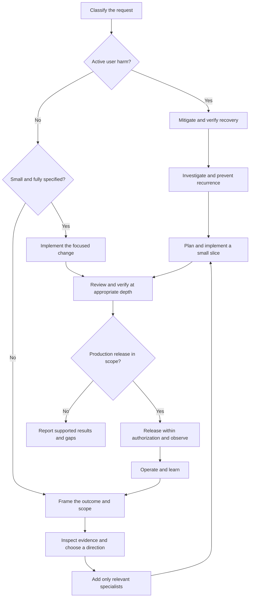

**Staff engineer skill workflow and alternatives**

**Recommendation:** Use a small set of skills selected by the decision in front of you. Start at the appropriate point in the workflow, add specialists when the work creates a concrete risk, and finish with evidence appropriate to the change. The 42 retained skills are a library of capabilities, not 42 mandatory steps.

This report builds on the [50-skill evaluation](REPORT.md), which kept 42 and dropped 8. Each original skill received one fresh-subagent scenario trial. The routing, handoffs, and replacement combinations below are recommendations synthesized from those trials; they have **not** been evaluated together as an end-to-end workflow. Drops for overlap or specialist scope do not establish poor quality. Sources remain pinned to the evaluated versions.

**How to enter the workflow**

| Situation | Start with | Next step | Keep the process proportionate |
|---|---|---|---|
| A small, fully specified edit | Inspect the affected code and implement directly | [verification-before-completion][s22] for a truthful completion claim | A diff inspection or focused UI check may be sufficient. No new design workshop, ADR, or test suite merely for a copy edit. |
| A feature request with an unclear problem | [product-discovery][s01] | [product-shaping][s08], then design or delivery | Investigate only uncertainties that could change what should be built. |
| A clear feature with material design choices | [software-architecture-analysis][s12] when existing boundaries are unclear; [software-architecture][s02] for the decision | Relevant specialists, then [implementation-planning][s05] | Reuse an established design when it already fits; do not manufacture an architecture decision. |
| A reproducible defect without current user harm | [systematic-debugging][s21] | [programming-principles][s04] and a meaningful regression test through [test-driven-development][s25] | Establish a discriminating hypothesis before changing behavior. |
| An active customer incident | [incident-runbook-templates][s34] and existing service procedures | Mitigate and verify recovery; investigate through [systematic-debugging][s21] in parallel when safe | Do not wait for full root-cause certainty before applying a known, reversible mitigation. |
| A performance or spend problem | [performance-optimization][s29] or [cost-optimization][s39] | [sql-optimization-patterns][s30] or [capacity-and-cost-engineering][s38] when evidence points there | Measure the actual constraint before choosing a rewrite, cache, index, or capacity cut. |
| A cross-team delivery problem | [technical-program-management][s06] | [implementation-planning][s05] for execution; [org-design][s50] for recurring ownership problems | Distinguish an unresolved dependency from an organizational structure that repeatedly creates dependencies. |



For a defect or optimization task, enter at investigation rather than repeating product discovery. The diagram shows typical flow; the entry table governs the starting point.

**The normal path for a substantial change**

| Stage | Leading skills | Decision and handoff |
|---|---|---|
| 1. Frame the outcome | [product-discovery][s01], [product-shaping][s08] | What problem is worth solving now, for whom, within what appetite? Hand off a bounded outcome and exclusions. Add [product-strategy][s09] or [product-roadmapping-and-portfolio][s10] only for direction or investment choices. |
| 2. Understand and decide | [software-architecture-analysis][s12], [software-architecture][s02] | What does the system actually do, and which option best fits the constraints? Hand off one recommendation, evidence, tradeoffs, and a revisit trigger. Use [technology-radar][s03] for new technology and [architecture-decision-records][s11] for durable choices. |
| 3. Protect the important invariants | [programming-principles][s04] plus relevant specialists | What must remain true about money, identity, tenant isolation, compatibility, or data? Resolve these issues during design. Hand off the contract, failure behavior, and checks. |
| 4. Deliver a useful slice | [implementation-planning][s05] | What is the smallest independently verifiable increment? Hand off real interfaces/files, dependencies, checks, and recovery. Use [technical-program-management][s06] for cross-team commitments and [dispatching-parallel-agents][s28] only for authorized, independent work. |
| 5. Implement and challenge | [programming-principles][s04], [test-driven-development][s25] where warranted, [code-review-excellence][s24] | Does the implementation preserve the intended behavior and failure paths? Use [receiving-code-review][s23] to evaluate advice. Prioritize correctness and risk over preference. |
| 6. Establish evidence | [verification-before-completion][s22]; [verification-methodology][s48] for semantic or complex claims | What is actually demonstrated on this version? Hand off evidence and remaining gaps. Row counts, old tests, and reviewer confidence do not establish correctness by themselves. |
| 7. Release and operate | [deployment-pipeline-design][s45], [site-reliability-engineering][s32] | Is exposure justified, observable, and recoverable? Hand off the verified artifact, owner, signals, exposure limit, and recovery procedure. Follow existing release authority and task authorization. |
| 8. Learn and improve | [postmortem-writing][s35], plus the relevant capacity, cost, platform, or organization skill | What should change based on observed outcomes? Feed owned improvements back into delivery rather than collecting unactioned recommendations. |

**Specialist selection**

Activate specialists while their constraints can still change the design. Security, privacy, compatibility, and data correctness should not first appear as a final review checklist. The full routing catalog below specifies their triggers. Typical selections are:

- **Public contracts:** API design and evolution; database migration if storage changes; verification methodology for semantic parity.
- **Money or cross-system state:** programming principles; saga orchestration only when separately committed actions need durable coordination; explicit reconciliation for unknown outcomes.
- **Identity and tenant boundaries:** secure software engineering, authentication patterns, and multi-tenant architecture according to the affected boundary.
- **Personal data:** privacy engineering from collection through deletion, including telemetry and restored backups.
- **Scale and spend:** performance profiling, SQL optimization, capacity engineering, or cost optimization according to measured evidence.
- **Operational resilience:** SLO definition, incident response, tracing, and recovery testing according to the actual failure modes.

**What makes this a staff-engineer workflow**

1. **Make a recommendation.** Name the preferred action, the strongest rejected alternative, the decisive evidence, and what would change the recommendation. Include doing less or retaining the current system when justified.
2. **Carry assumptions forward.** Separate observed facts, proposed targets, unknowns, and accepted constraints. A proposed owner, deadline, or threshold is not an agreement or a measurement.
3. **Use the smallest sufficient process.** One skill can own the current decision. Consult additional skills for a specific question and hand their result back. A small change may need a few sentences rather than a separate document.
4. **Respect reversibility and consequences.** A code rollback cannot reverse a charge, restore a dropped column, or recall exposed data. Identify the real recovery boundary.
5. **Protect end-to-end ownership.** A plan is credible when dependencies have acceptance evidence and an accountable receiver. Team velocity and a green status label do not prove delivery.
6. **Keep claims bounded by evidence.** Distinguish implementation, review, execution, deployment, and observed production behavior. Repeat checks when relevant changes invalidate them, not as ceremony.

Read the selected skill's actual SKILL.md and relevant references on demand. Do not load all 42 into every task. User instructions and established repository policies govern scope and authority; skill templates do not create new approval requirements or authorize publication. Delegate only where authorized, with explicit ownership and an integration check.

**A compact handoff between stages or agents**

```text
Outcome and scope:
Decision and why:
Evidence and important unknowns:
Invariants and acceptance checks:
Next action, owner/dependency, and recovery boundary:
```

Use this as a thinking aid. Omit fields that add no useful information, and keep the handoff in the existing ticket or plan rather than creating another document automatically. In an incident, include the next timed action and escalation condition.

**Alternatives for the eight dropped skills**

The replacements below are retained skills that performed well in their individual trials. They replace the default role of the dropped package in this workflow. Specialized implementation catalogs are not interchangeable with general decision guidance; reconsider those original packages when their narrower use case is actually present.

| Dropped skill and trial | Why it was dropped | Retained alternative and expected output | When the original may be useful |
|---|---|---|---|
| [technical-project-management][s07] · [trial](results/07.md) | The trial was proportionate and technically sound, but duplicated retained planning coverage. | [implementation-planning][s05], [technical-program-management][s06]. Use implementation-planning for a team's delivery. Add technical-program-management only when another team's commitment is on the critical path. **Deliver:** One plan or ticket with outcome, owners, dependencies, checks and current blockers. | An organization explicitly needs a project-management method or reporting structure beyond the retained delivery workflow. |
| [architecture-patterns][s15] · [trial](results/15.md) | The trial rejected unnecessary layering; that decision is already covered by broader architecture guidance. | [software-architecture-analysis][s12], [software-architecture][s02], [programming-principles][s04]. Inspect actual coupling with software-architecture-analysis, choose the boundary with software-architecture, and implement the smallest seam using programming-principles. **Deliver:** Observed coupling, chosen seam, preserved invariant and focused tests; no obligatory repositories, adapters or events. | A chosen architecture genuinely needs a specific pattern implementation reference. This was not a verdict that the patterns are invalid. |
| [microservices-patterns][s16] · [trial](results/16.md) | It correctly declined a service split; specialized extraction guidance added little to the core selection. | [software-architecture][s02], [software-architecture-analysis][s12], [capacity-and-cost-engineering][s38], [site-reliability-engineering][s32]. Establish boundaries and measured scaling/release constraints first. Evaluate failure capacity and operational ownership before choosing extraction. **Deliver:** Evidence that one capability needs independent scaling, delivery or isolation; owner, cost, data boundary and recovery plan. | Service extraction is already justified. The original may then be a useful specialist reference; this combination is not a full replacement for its implementation catalog. |
| [cqrs-implementation][s17] · [trial](results/17.md) | It correctly recommended ordinary CRUD and reporting; the scenario did not justify independent read/write models. | [performance-optimization][s29], [sql-optimization-patterns][s30], [software-architecture][s02], [programming-principles][s04]. Measure the reporting/query problem, optimize the simple read path, and decide whether distinct consistency and scaling requirements truly warrant separate models. **Deliver:** Measured bottleneck, simple option evaluated, required freshness and consistency, model/operational cost. | Read/write workloads or domain models demonstrably diverge. CQRS and event sourcing remain separate choices; a dedicated CQRS reference may be warranted then. |
| [writing-plans][s26] · [trial](results/26.md) | The plan was usable, but added assumed technology/file details and duplicated retained planning guidance. | [implementation-planning][s05], [verification-before-completion][s22]. Write a proportionate implementation plan using inspected repository paths and actual interfaces. Define evidence of completion without scripting every keystroke. **Deliver:** Goal, affected components, ordered slices, meaningful checks, recovery notes and uncertainty. | A delegated implementation requires an unusually explicit plan, and its detail is grounded in the actual repository rather than guessed. |
| [brainstorming][s27] · [trial](results/27.md) | The trial honored a trivial-change fast path; it did not establish added value for open-ended discovery. | [product-discovery][s01], [product-shaping][s08]. Use product-discovery when the problem is uncertain and product-shaping when the problem is clear but scope is broad. Execute fully specified small changes directly. **Deliver:** Known outcome, material unknowns, bounded next step and exclusions only where needed. | Open-ended creative facilitation or visual exploration is the actual task. That use case was not tested; the drop is not evidence that it performs poorly there. |
| [production-readiness][s31] · [trial](results/31.md) | It correctly recommended no-go, but turned a minimum-readiness request into eleven evidence categories. | [site-reliability-engineering][s32], [deployment-pipeline-design][s45], [incident-runbook-templates][s34]. Combine a reliability decision, an executable release/recovery path, and a short incident runbook. Add security, privacy, migration or disaster-recovery expertise only for applicable risks. **Deliver:** Five questions below: owner, behavioral evidence, user-impact signals, compatible recovery, and bounded exposure. | A high-risk service or established organizational policy requires a comprehensive readiness review. Simplification never waives an applicable requirement. |
| [ai-debt-detector][s49] · [trial](results/49.md) | It caught swallowed errors and tenant-isolation gaps, but overlapped retained review and security guidance. | [code-review-excellence][s24], [secure-software-engineering][s41], [programming-principles][s04], [test-driven-development][s25]. Review failure paths and negative authorization behavior first. Simplify unjustified abstraction, verify dependency APIs/cleanup, and add regression tests for real failure modes. **Deliver:** Prioritized defects, evidence, focused fix, negative-path tests and remaining uncertainty. | Repeated measured defects in generated code escape the retained workflow and a dedicated checklist shows added value. |

**A proportionate replacement for the dropped production-readiness package**

For the tested checkout case, the three known blockers were operational ownership, recovery, and user-impact monitoring. Use [site-reliability-engineering][s32] to make the launch recommendation, [deployment-pipeline-design][s45] to establish rollout/recovery behavior, and [incident-runbook-templates][s34] to make response usable. Answer five questions with service-specific evidence:

| Question | Useful evidence |
|---|---|
| Who owns the change and response? | A named release/incident owner, appropriate responder coverage, and a working escalation path. |
| Does the important behavior work on the candidate? | Current checks for the critical user journey and relevant failure/compatibility paths. |
| Can we detect user harm? | Customer-outcome signals, baseline, explicit abort criteria, and a way to detect missing telemetry. |
| Can we recover compatibly? | Applicable rollback, roll-forward, reconciliation, or restore steps, including data and external-side-effect limits. |
| Can we bound exposure and decide what follows? | Canary/cohort or other exposure limit, observation criteria, and clear expand/hold/recover action. |

These questions are a starting point for that class of release, not a universal certification. A data-loss risk calls for [resilience-and-recovery][s37]; access-control changes call for [secure-software-engineering][s41]; a live schema change calls for [database-migration][s19]. Existing requirements remain applicable. Add the relevant review because the risk exists, not because a template contains a category.

**Worked examples**

| Task | Suggested route | Expected staff-level result |
|---|---|---|
| Change an approved button label | Inspect and edit → proportionate check → [verification-before-completion][s22] | Exact copy change with a truthful description of what was checked; no rediscovery or architecture work. |
| Payment retries create duplicate charges | Mitigate ongoing harm with [incident-runbook-templates][s34] → [systematic-debugging][s21] → [programming-principles][s04] → [test-driven-development][s25] → review and evidence | Stable logical payment identity, safe handling of unknown outcomes, reconciliation, and a regression that would catch the original bug. Add saga guidance only if multiple committed business actions require it. |
| Replace floating-point prices in a public API | [api-design-and-evolution][s13] leads; [implementation-planning][s05] sequences; [database-migration][s19] if needed; [verification-methodology][s48] checks meaning; [deployment-pipeline-design][s45] rolls out | Exact money semantics, compatible clients, independent value reconciliation, and conditional retirement of the old contract. |
| Prepare a monolith for forecast growth | [software-architecture-analysis][s12] → [software-architecture][s02], with [performance-optimization][s29] or [capacity-and-cost-engineering][s38] supplying evidence | A measured bottleneck and failure-capacity model determine the action. Microservice extraction becomes an option only when its benefits and operational cost are demonstrated. |
| Three layer teams deliver features slowly | [org-design][s50] diagnoses ownership; [technical-program-management][s06] makes current dependencies visible | A bounded change in end-to-end ownership, explicit displaced work, and measured lead time/quality/team-health results before broader reorganization. |

Each arrow indicates a useful handoff, not an instruction to run every package in full. Review and evidence scale with the failure cost and existing coverage.

**Complete routing catalog: all 42 retained skills**

Each skill name links to the exact source version evaluated. Trial links show the individual work product underlying the selection. The CSV companion preserves the same triggers, outputs, and handoffs for reuse.

**Frame**

| Skill and trial | Use when | Produce | Handoff |
|---|---|---|---|
| [product-discovery][s01] · [trial](results/01.md) | A request names a feature but the user problem or evidence is unclear. | Problem statement, affected users, evidence gaps, smallest learning experiment. | [product-shaping][s08] once the problem is sufficiently understood; [product-strategy][s09] only for strategic choices. |
| [product-strategy][s09] · [trial](results/09.md) | Business direction, target market, or investment focus is contested. | Recommended focus, economic assumptions, opportunity cost, reversal evidence. | [product-roadmapping-and-portfolio][s10] for competing investments; [product-shaping][s08] for a selected opportunity. |
| [product-roadmapping-and-portfolio][s10] · [trial](results/10.md) | Several worthwhile initiatives exceed available capacity. | Capacity-feasible portfolio, deferred work, deadlines, benefit confidence. | [product-shaping][s08] then [implementation-planning][s05] for funded work. |
| [product-shaping][s08] · [trial](results/08.md) | A useful outcome is known but the requested solution is too broad. | Small release, appetite, exclusions, essential constraints, stopping rule. | [software-architecture][s02] if design choices are consequential; otherwise [implementation-planning][s05] or direct implementation. |

**Understand and decide**

| Skill and trial | Use when | Produce | Handoff |
|---|---|---|---|
| [software-architecture-analysis][s12] · [trial](results/12.md) | An existing system's boundaries, ownership, or coupling are uncertain. | Evidence-backed current-state map with unknowns explicitly marked. | [software-architecture][s02] for design; [systematic-debugging][s21] for a defect; [performance-optimization][s29] for performance. |
| [software-architecture][s02] · [trial](results/02.md) | A consequential structural choice, rewrite, or service split is proposed. | One recommendation, credible alternatives, tradeoffs, reversible first step, revisit triggers. | [architecture-decision-records][s11] for durable rationale; selected specialist; [implementation-planning][s05] for delivery. |
| [technology-radar][s03] · [trial](results/03.md) | A new technology, vendor, or platform standard is being considered. | Adopt/trial/assess/hold recommendation, cost and exit analysis, bounded experiment. | [software-architecture][s02] for system implications; [architecture-decision-records][s11] when a durable decision is made. |
| [architecture-decision-records][s11] · [trial](results/11.md) | A significant choice will constrain future engineers or is costly to reverse. | Short decision record: context, choice, rejected options, consequences, revisit trigger. | [implementation-planning][s05] and implementation; update the record only when the decision changes. |

**Design and implement**

| Skill and trial | Use when | Produce | Handoff |
|---|---|---|---|
| [programming-principles][s04] · [trial](results/04.md) | Correctness, coupling, state ownership, retries, or unnecessary abstractions need judgment. | Explicit invariants and the smallest implementation that preserves them. | [test-driven-development][s25] for meaningful regression cases; [code-review-excellence][s24] for review. |
| [api-design-and-evolution][s13] · [trial](results/13.md) | A public API, event contract, or client-visible representation changes. | Precise contract, consumer inventory, compatibility strategy, deprecation conditions. | [database-migration][s19] if storage changes; [verification-methodology][s48] for semantic checks; [deployment-pipeline-design][s45] for rollout. |
| [multi-tenant-saas-architecture][s14] · [trial](results/14.md) | Tenant isolation, shared resources, or enterprise isolation promises change. | Tenant boundaries, enforcement points, placement economics, cross-tenant invariants. | [secure-software-engineering][s41]/[auth-implementation-patterns][s44] for access controls; [database-migration][s19] for data movement; [capacity-and-cost-engineering][s38] for resource cost. |
| [saga-orchestration][s18] · [trial](results/18.md) | A workflow spans separately committed systems or irreversible business actions. | Durable states, idempotency, compensation limits, reconciliation and escalation. | [test-driven-development][s25]/[verification-methodology][s48] for failure cases; [incident-runbook-templates][s34] for operational recovery. |
| [database-migration][s19] · [trial](results/19.md) | A schema or stored-data change must coexist with live traffic or old versions. | Expand/backfill/validate/contract sequence, lock budgets, compatibility and recovery limits. | [verification-methodology][s48] before promotion; [deployment-pipeline-design][s45] for coordinated release. |
| [dependency-upgrade][s20] · [trial](results/20.md) | A dependency upgrade changes behavior or mitigates a vulnerability. | Exposure containment, dependency/compatibility analysis, focused upgrade and recovery plan. | [test-driven-development][s25]/[code-review-excellence][s24] for changed behavior; [deployment-pipeline-design][s45] after relevant verification. |
| [secure-software-engineering][s41] · [trial](results/41.md) | The change crosses trust boundaries or handles permissions, secrets, or sensitive actions. | Prioritized threats, server-enforced authorization, negative tests, exposure containment. | [threat-mitigation-mapping][s42] for explicit control mapping; [auth-implementation-patterns][s44] for session design; [code-review-excellence][s24]/[verification-methodology][s48] for verification. |
| [threat-mitigation-mapping][s42] · [trial](results/42.md) | Several identified threats need concrete, testable controls. | Threat-to-control mapping with residual risk and verification cases. | [secure-software-engineering][s41] for implementation; [verification-methodology][s48] for effectiveness evidence. |
| [privacy-engineering][s43] · [trial](results/43.md) | Personal data collection, telemetry, retention, exports, or deletion changes. | Purpose-limited data model, retention/deletion lifecycle, deletion verification. | [api-design-and-evolution][s13]/[database-migration][s19] for contracts/storage; [technical-documentation][s47] for operator instructions; [verification-methodology][s48] for evidence. |
| [auth-implementation-patterns][s44] · [trial](results/44.md) | Login, sessions, account linking, revocation, or permission enforcement changes. | Authentication/session contract, revocation semantics, authorization and CSRF/XSS checks. | [secure-software-engineering][s41] for broader exposure review; [test-driven-development][s25]/[verification-methodology][s48] for security regressions. |

**Deliver**

| Skill and trial | Use when | Produce | Handoff |
|---|---|---|---|
| [implementation-planning][s05] · [trial](results/05.md) | Work has meaningful sequencing, dependencies, or implementation uncertainty. | Smallest useful slice, real files/interfaces, owners where needed, checks, recovery and exclusions. | [programming-principles][s04] and relevant specialists; [technical-program-management][s06] only for cross-team dependencies. |
| [technical-program-management][s06] · [trial](results/06.md) | Multiple teams or external dependencies determine delivery. | Provider/consumer ownership, acceptance evidence, critical path, forecast and escalation decisions. | [implementation-planning][s05] for team-level execution; [org-design][s50] if ownership structure is the recurring bottleneck. |
| [dispatching-parallel-agents][s28] · [trial](results/28.md) | Authorized delegation can separate independent work with clear file/resource ownership. | Self-contained task packets, exclusive ownership, integration owner and combined checks. | [code-review-excellence][s24]/[verification-before-completion][s22] after integration; serialize tasks that share mutable state. |
| [test-driven-development][s25] · [trial](results/25.md) | A behavior change or defect merits a regression test. | Deterministic failing case, minimal fix, observed red/green evidence and relevant edge cases. | [code-review-excellence][s24] for review; [verification-before-completion][s22] for the final evidence claim. |

**Investigate**

| Skill and trial | Use when | Produce | Handoff |
|---|---|---|---|
| [systematic-debugging][s21] · [trial](results/21.md) | A defect, failed test, or unexpected behavior lacks an established cause. | Reproduction, boundary evidence, falsifiable hypothesis, discriminating experiment. | [programming-principles][s04]/[test-driven-development][s25] for the fix; use [incident-runbook-templates][s34] first if users are currently harmed. |
| [performance-optimization][s29] · [trial](results/29.md) | Latency, throughput, or resource consumption is a measured problem. | Profile, dominant constraint, one proposed change, comparable benchmark and rollback criteria. | [sql-optimization-patterns][s30] if SQL dominates; [capacity-and-cost-engineering][s38] if capacity dominates; [verification-before-completion][s22] for measured claims. |
| [sql-optimization-patterns][s30] · [trial](results/30.md) | Query plans or database contention show SQL is the bottleneck. | Plan evidence, focused query/index change, write/storage cost and safe deployment steps. | [database-migration][s19] if schema rollout is material; [performance-optimization][s29] for before/after workload checks. |
| [distributed-tracing][s40] · [trial](results/40.md) | A request crosses services or queues and its time/failure location is unclear. | Trace propagation, async correlation, safe attributes, sampling limits and verification. | [systematic-debugging][s21]/[performance-optimization][s29] to use the evidence; [secure-software-engineering][s41]/[privacy-engineering][s43] when telemetry exposes sensitive data. |

**Review and verify**

| Skill and trial | Use when | Produce | Handoff |
|---|---|---|---|
| [code-review-excellence][s24] · [trial](results/24.md) | A meaningful implementation or design needs correctness review. | Prioritized findings, reproduction/acceptance evidence, blockers separated from preferences. | [programming-principles][s04]/[test-driven-development][s25] for fixes; [receiving-code-review][s23] for responding to contested feedback. |
| [receiving-code-review][s23] · [trial](results/23.md) | Review feedback is unclear, questionable, or changes scope. | Technically justified acceptance or pushback and a concrete alternative. | Implement accepted changes; reverify affected behavior with [verification-before-completion][s22]. |
| [verification-methodology][s48] · [trial](results/48.md) | Counts or happy-path tests cannot establish semantic correctness. | Explicit criteria, independent oracle, invariant reconciliation, candidate-bound evidence and verdict. | [database-migration][s19]/[api-design-and-evolution][s13]/[saga-orchestration][s18] owner resolves discrepancies; [verification-before-completion][s22] communicates only supported claims. |
| [verification-before-completion][s22] · [trial](results/22.md) | About to say done, fixed, tested, migrated, or ready. | Fresh evidence appropriate to the change; explicit verified, failed, unrun and blocked claims. | Authorized release via [deployment-pipeline-design][s45] when applicable, or a truthful completion report. |

**Release and operate**

| Skill and trial | Use when | Produce | Handoff |
|---|---|---|---|
| [slo-implementation][s33] · [trial](results/33.md) | A service needs a measurable reliability contract or existing metrics miss user outcomes. | SLI numerator/denominator, objective/window, error budget and useful alerts. | [site-reliability-engineering][s32] for operational policy; [deployment-pipeline-design][s45]/[incident-runbook-templates][s34] for rollout and response criteria. |
| [site-reliability-engineering][s32] · [trial](results/32.md) | Reliability risk, alert quality, or error-budget consumption affects a decision. | User-impact assessment, release recommendation, prioritized reliability work and recovery signals. | [deployment-pipeline-design][s45] for release; [incident-runbook-templates][s34] for incident action; [slo-implementation][s33] if the measurement contract is missing. |
| [deployment-pipeline-design][s45] · [trial](results/45.md) | A production change needs controlled promotion and recovery. | Verified artifact, preproduction checks, compatible migration order, exposure limits and abort/recovery steps. | [site-reliability-engineering][s32] observes outcomes; [incident-runbook-templates][s34] responds to harm; [verification-before-completion][s22] limits completion claims. |
| [incident-runbook-templates][s34] · [trial](results/34.md) | A live incident needs immediate action, or a risky path needs a recovery runbook. | Mitigation sequence, operator/owner, escalation, rollback branch and proof of recovery. | [systematic-debugging][s21] during/after stabilization; [on-call-handoff-patterns][s36] on handoff; [postmortem-writing][s35] after stabilization. |
| [on-call-handoff-patterns][s36] · [trial](results/36.md) | Responsibility changes while risk or unfinished operational work remains. | Named owner, current state, next timed action, escalation threshold and acknowledgment. | Incoming responder continues [incident-runbook-templates][s34]; keep uncertain facts explicit. |
| [postmortem-writing][s35] · [trial](results/35.md) | An incident has stabilized and lessons need durable follow-through. | Blameless causal analysis, confidence limits, prioritized owned actions with closure evidence. | [implementation-planning][s05]/[technical-program-management][s06] implement prevention; [slo-implementation][s33]/[incident-runbook-templates][s34] update measurement and response. |
| [resilience-and-recovery][s37] · [trial](results/37.md) | Data-loss, disaster recovery, or resilience requirements need demonstrated capability. | Business recovery scope, RPO/RTO, trusted recovery path and timed restore/integrity evidence. | [database-migration][s19]/[deployment-pipeline-design][s45] for system changes; [incident-runbook-templates][s34]/[technical-documentation][s47] for usable recovery instructions. |

**Improve the system**

| Skill and trial | Use when | Produce | Handoff |
|---|---|---|---|
| [capacity-and-cost-engineering][s38] · [trial](results/38.md) | Growth, failures, quotas, or infrastructure choices require capacity judgment. | Demand model, degraded-state capacity, headroom, cost and load/failover validation. | [software-architecture][s02] for architecture; [deployment-pipeline-design][s45] for capacity changes; [cost-optimization][s39] for efficiency work. |
| [cost-optimization][s39] · [trial](results/39.md) | Cloud spend needs reduction without hidden reliability loss. | Prioritized savings experiments, measured bill effect, risk controls and rollback. | [capacity-and-cost-engineering][s38] checks capacity; [site-reliability-engineering][s32] protects reliability; [verification-before-completion][s22] distinguishes estimates from savings. |
| [platform-engineering][s46] · [trial](results/46.md) | An internal platform or shared developer tool needs investment or adoption decisions. | Validated user bottleneck, small self-service offer, voluntary pilot and outcome/stop criteria. | [product-shaping][s08]/[implementation-planning][s05] deliver the slice; [technical-program-management][s06] coordinates actual dependencies. |
| [technical-documentation][s47] · [trial](results/47.md) | A change creates a new operator, developer, or consumer task. | Task-oriented instructions, real examples, failure handling and verification steps. | [incident-runbook-templates][s34]/[on-call-handoff-patterns][s36] for operations; [api-design-and-evolution][s13] for consumer migrations; verify commands before publication. |
| [org-design][s50] · [trial](results/50.md) | Recurring handoffs and local incentives prevent end-to-end delivery. | Ownership diagnosis, bounded organizational experiment, decision rights and flow/health measures. | [technical-program-management][s06] tracks dependencies during the experiment; [product-roadmapping-and-portfolio][s10] adjusts displaced commitments. |


**Using and maintaining this report**

Use the [original evaluation](REPORT.md) to inspect keep/drop reasoning and [all trial evidence](staff-engineer-skills-evidence.zip) to inspect scenarios and outputs. This document recommends selective use; it does not install or enable skills. The plain-language workflow and replacement combinations are new synthesis, not additional tested packages.

When adopting this workflow, test a representative small task, a risky change, and an incident exercise. Record correctness issues, unnecessary questions, useful decisions, elapsed effort, and review findings. Compare with the existing workflow before claiming an improvement. Change one routing rule at a time. Re-evaluate on materially different skill versions rather than assuming the pinned results still apply.

[s01]: https://github.com/magnus919/agent-skills/blob/06ca706ecaa80f6afb31ae28eb160d39372b7267/product-discovery/SKILL.md
[s02]: https://github.com/magnus919/agent-skills/blob/06ca706ecaa80f6afb31ae28eb160d39372b7267/software-architecture/SKILL.md
[s03]: https://github.com/magnus919/agent-skills/blob/06ca706ecaa80f6afb31ae28eb160d39372b7267/technology-radar/SKILL.md
[s04]: https://github.com/magnus919/agent-skills/blob/06ca706ecaa80f6afb31ae28eb160d39372b7267/programming-principles/SKILL.md
[s05]: https://github.com/magnus919/agent-skills/blob/06ca706ecaa80f6afb31ae28eb160d39372b7267/implementation-planning/SKILL.md
[s06]: https://github.com/magnus919/agent-skills/blob/06ca706ecaa80f6afb31ae28eb160d39372b7267/technical-program-management/SKILL.md
[s07]: https://github.com/magnus919/agent-skills/blob/06ca706ecaa80f6afb31ae28eb160d39372b7267/technical-project-management/SKILL.md
[s08]: https://github.com/magnus919/agent-skills/blob/06ca706ecaa80f6afb31ae28eb160d39372b7267/product-shaping/SKILL.md
[s09]: https://github.com/magnus919/agent-skills/blob/06ca706ecaa80f6afb31ae28eb160d39372b7267/product-strategy/SKILL.md
[s10]: https://github.com/magnus919/agent-skills/blob/06ca706ecaa80f6afb31ae28eb160d39372b7267/product-roadmapping-and-portfolio/SKILL.md
[s11]: https://github.com/wshobson/agents/blob/0874a27b17a22e2b7c2e2bcd725768e0803cad06/plugins/documentation-generation/skills/architecture-decision-records/SKILL.md
[s12]: https://github.com/magnus919/agent-skills/blob/06ca706ecaa80f6afb31ae28eb160d39372b7267/software-architecture-analysis/SKILL.md
[s13]: https://github.com/magnus919/agent-skills/blob/06ca706ecaa80f6afb31ae28eb160d39372b7267/api-design-and-evolution/SKILL.md
[s14]: https://github.com/magnus919/agent-skills/blob/06ca706ecaa80f6afb31ae28eb160d39372b7267/multi-tenant-saas-architecture/SKILL.md
[s15]: https://github.com/wshobson/agents/blob/0874a27b17a22e2b7c2e2bcd725768e0803cad06/plugins/backend-development/skills/architecture-patterns/SKILL.md
[s16]: https://github.com/wshobson/agents/blob/0874a27b17a22e2b7c2e2bcd725768e0803cad06/plugins/backend-development/skills/microservices-patterns/SKILL.md
[s17]: https://github.com/wshobson/agents/blob/0874a27b17a22e2b7c2e2bcd725768e0803cad06/plugins/backend-development/skills/cqrs-implementation/SKILL.md
[s18]: https://github.com/wshobson/agents/blob/0874a27b17a22e2b7c2e2bcd725768e0803cad06/plugins/backend-development/skills/saga-orchestration/SKILL.md
[s19]: https://github.com/wshobson/agents/blob/0874a27b17a22e2b7c2e2bcd725768e0803cad06/plugins/framework-migration/skills/database-migration/SKILL.md
[s20]: https://github.com/wshobson/agents/blob/0874a27b17a22e2b7c2e2bcd725768e0803cad06/plugins/framework-migration/skills/dependency-upgrade/SKILL.md
[s21]: https://github.com/obra/superpowers/blob/bb92a77741419a4ab5f06e711a283343f1ada0c3/skills/systematic-debugging/SKILL.md
[s22]: https://github.com/obra/superpowers/blob/bb92a77741419a4ab5f06e711a283343f1ada0c3/skills/verification-before-completion/SKILL.md
[s23]: https://github.com/obra/superpowers/blob/bb92a77741419a4ab5f06e711a283343f1ada0c3/skills/receiving-code-review/SKILL.md
[s24]: https://github.com/wshobson/agents/blob/0874a27b17a22e2b7c2e2bcd725768e0803cad06/plugins/developer-essentials/skills/code-review-excellence/SKILL.md
[s25]: https://github.com/obra/superpowers/blob/bb92a77741419a4ab5f06e711a283343f1ada0c3/skills/test-driven-development/SKILL.md
[s26]: https://github.com/obra/superpowers/blob/bb92a77741419a4ab5f06e711a283343f1ada0c3/skills/writing-plans/SKILL.md
[s27]: https://github.com/obra/superpowers/blob/bb92a77741419a4ab5f06e711a283343f1ada0c3/skills/brainstorming/SKILL.md
[s28]: https://github.com/obra/superpowers/blob/bb92a77741419a4ab5f06e711a283343f1ada0c3/skills/dispatching-parallel-agents/SKILL.md
[s29]: https://github.com/magnus919/agent-skills/blob/06ca706ecaa80f6afb31ae28eb160d39372b7267/performance-optimization/SKILL.md
[s30]: https://github.com/wshobson/agents/blob/0874a27b17a22e2b7c2e2bcd725768e0803cad06/plugins/developer-essentials/skills/sql-optimization-patterns/SKILL.md
[s31]: https://github.com/magnus919/agent-skills/blob/06ca706ecaa80f6afb31ae28eb160d39372b7267/production-readiness/SKILL.md
[s32]: https://github.com/magnus919/agent-skills/blob/06ca706ecaa80f6afb31ae28eb160d39372b7267/site-reliability-engineering/SKILL.md
[s33]: https://github.com/wshobson/agents/blob/0874a27b17a22e2b7c2e2bcd725768e0803cad06/plugins/observability-monitoring/skills/slo-implementation/SKILL.md
[s34]: https://github.com/wshobson/agents/blob/0874a27b17a22e2b7c2e2bcd725768e0803cad06/plugins/incident-response/skills/incident-runbook-templates/SKILL.md
[s35]: https://github.com/wshobson/agents/blob/0874a27b17a22e2b7c2e2bcd725768e0803cad06/plugins/incident-response/skills/postmortem-writing/SKILL.md
[s36]: https://github.com/wshobson/agents/blob/0874a27b17a22e2b7c2e2bcd725768e0803cad06/plugins/incident-response/skills/on-call-handoff-patterns/SKILL.md
[s37]: https://github.com/magnus919/agent-skills/blob/06ca706ecaa80f6afb31ae28eb160d39372b7267/resilience-and-recovery/SKILL.md
[s38]: https://github.com/magnus919/agent-skills/blob/06ca706ecaa80f6afb31ae28eb160d39372b7267/capacity-and-cost-engineering/SKILL.md
[s39]: https://github.com/wshobson/agents/blob/0874a27b17a22e2b7c2e2bcd725768e0803cad06/plugins/cloud-infrastructure/skills/cost-optimization/SKILL.md
[s40]: https://github.com/wshobson/agents/blob/0874a27b17a22e2b7c2e2bcd725768e0803cad06/plugins/observability-monitoring/skills/distributed-tracing/SKILL.md
[s41]: https://github.com/magnus919/agent-skills/blob/06ca706ecaa80f6afb31ae28eb160d39372b7267/secure-software-engineering/SKILL.md
[s42]: https://github.com/wshobson/agents/blob/0874a27b17a22e2b7c2e2bcd725768e0803cad06/plugins/security-scanning/skills/threat-mitigation-mapping/SKILL.md
[s43]: https://github.com/magnus919/agent-skills/blob/06ca706ecaa80f6afb31ae28eb160d39372b7267/privacy-engineering/SKILL.md
[s44]: https://github.com/wshobson/agents/blob/0874a27b17a22e2b7c2e2bcd725768e0803cad06/plugins/developer-essentials/skills/auth-implementation-patterns/SKILL.md
[s45]: https://github.com/wshobson/agents/blob/0874a27b17a22e2b7c2e2bcd725768e0803cad06/plugins/cicd-automation/skills/deployment-pipeline-design/SKILL.md
[s46]: https://github.com/magnus919/agent-skills/blob/06ca706ecaa80f6afb31ae28eb160d39372b7267/platform-engineering/SKILL.md
[s47]: https://github.com/magnus919/agent-skills/blob/06ca706ecaa80f6afb31ae28eb160d39372b7267/technical-documentation/SKILL.md
[s48]: https://github.com/magnus919/agent-skills/blob/06ca706ecaa80f6afb31ae28eb160d39372b7267/verification-methodology/SKILL.md
[s49]: https://github.com/wshobson/agents/blob/0874a27b17a22e2b7c2e2bcd725768e0803cad06/plugins/skill-forge-essentials/skills/ai-debt-detector/SKILL.md
[s50]: https://github.com/magnus919/agent-skills/blob/06ca706ecaa80f6afb31ae28eb160d39372b7267/org-design/SKILL.md
