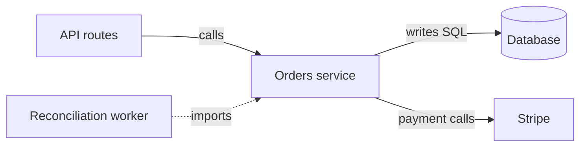

The actual shape is layered entry points sharing an orders service that mixes order behavior, SQL persistence, and Stripe integration. The README’s “clean hexagonal architecture” claim is unsupported: direct payment dependencies lack an application-owned interface.

These are reported scenario facts, not independently inspected observations. The worker’s import does not establish its executed operations.

| Coupling lens | Assessment |
|---|---|
| Static | Reported: API and worker share a concrete module; payment calls lack interfaces. |
| Dynamic | Reported: orders calls Stripe. Inferred: provider behavior affects order execution. |
| Data | Reported: orders writes SQL; tables, other writers, and invariant ownership are unknown. |
| Temporal | SQL/payment ordering, retries, and reconciliation timing are unknown. |
| Deployment | Processes, release coupling, and scaling needs are unknown. |
| Organizational | Team and operational ownership are unknown. |

**First improvement: introduce an application-owned payment port and a Stripe adapter.** Assume the goal is testability and isolation of provider changes. Inventory payment operations used by orders and the worker; define the smallest contract they require, using application-level inputs, results, and failure categories. Keep Stripe SDK types inside the adapter. Supply that adapter at API/worker startup, preserving shared order behavior.

Proposed acceptance checks: orders runs against a fake payment provider; only the adapter imports Stripe; both entry points preserve characterized success/failure behavior. Stop and revise if the contract leaks Stripe types or extraction changes transaction ordering.

Direct SQL remains a separate persistence concern; this seam alone does not establish hexagonal architecture or atomic database/payment updates. Trace payment-success/database-failure and ambiguous-timeout recovery before changing retries. The worker’s name proves no recovery guarantee. Update the README to reflect actual dependencies. Service extraction readiness: **insufficient evidence; needs seam work**.

Skill guidance used: Phase 3’s evidence labels, the coupling reference’s six lenses and reversible boundary probe, and the workflow reference’s transaction/reconciliation cautions. No repository, traces, or tests were supplied, so no execution or verification is claimed. This is an architecture assessment and proposed change; detailed contract design and implementation belong to subsequent API/backend engineering work.
