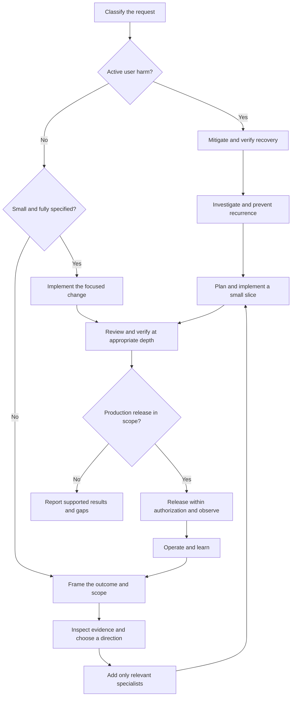

**Staff engineer skill workflow and alternatives**

**Recommendation:** Use a small set of skills selected by the decision in front of you. Start at the appropriate point in the workflow, add specialists when the work creates a concrete risk, and finish with evidence appropriate to the change. The 42 retained skills are a library of capabilities, not 42 mandatory steps.

This report builds on the [50-skill evaluation](REPORT.md), which kept 42 and dropped 8. Each original skill received one fresh-subagent scenario trial. The routing, handoffs, and replacement combinations below are recommendations synthesized from those trials; they have **not** been evaluated together as an end-to-end workflow. Drops for overlap or specialist scope do not establish poor quality. Sources remain pinned to the evaluated versions.

**How to enter the workflow**

| Situation | Start with | Next step | Keep the process proportionate |
|---|---|---|---|
| A small, fully specified edit | Inspect the affected code and implement directly | [verification-before-completion][s22] for a truthful completion claim | A diff inspection or focused UI check may be sufficient. No new design workshop, ADR, or test suite merely for a copy edit. |
| A feature request with an unclear problem | [product-discovery][s01] | [product-shaping][s08], then design or delivery | Investigate only uncertainties that could change what should be built. |
| A clear feature with material design choices | [software-architecture-analysis][s12] when existing boundaries are unclear; [software-architecture][s02] for the decision | Relevant specialists, then [implementation-planning][s05] | Reuse an established design when it already fits; do not manufacture an architecture decision. |
| A reproducible defect without current user harm | [systematic-debugging][s21] | [programming-principles][s04] and a meaningful regression test through [test-driven-development][s25] | Establish a discriminating hypothesis before changing behavior. |
| An active customer incident | [incident-runbook-templates][s34] and existing service procedures | Mitigate and verify recovery; investigate through [systematic-debugging][s21] in parallel when safe | Do not wait for full root-cause certainty before applying a known, reversible mitigation. |
| A performance or spend problem | [performance-optimization][s29] or [cost-optimization][s39] | [sql-optimization-patterns][s30] or [capacity-and-cost-engineering][s38] when evidence points there | Measure the actual constraint before choosing a rewrite, cache, index, or capacity cut. |
| A cross-team delivery problem | [technical-program-management][s06] | [implementation-planning][s05] for execution; [org-design][s50] for recurring ownership problems | Distinguish an unresolved dependency from an organizational structure that repeatedly creates dependencies. |



For a defect or optimization task, enter at investigation rather than repeating product discovery. The diagram shows typical flow; the entry table governs the starting point.

**The normal path for a substantial change**

| Stage | Leading skills | Decision and handoff |
|---|---|---|
| 1. Frame the outcome | [product-discovery][s01], [product-shaping][s08] | What problem is worth solving now, for whom, within what appetite? Hand off a bounded outcome and exclusions. Add [product-strategy][s09] or [product-roadmapping-and-portfolio][s10] only for direction or investment choices. |
| 2. Understand and decide | [software-architecture-analysis][s12], [software-architecture][s02] | What does the system actually do, and which option best fits the constraints? Hand off one recommendation, evidence, tradeoffs, and a revisit trigger. Use [technology-radar][s03] for new technology and [architecture-decision-records][s11] for durable choices. |
| 3. Protect the important invariants | [programming-principles][s04] plus relevant specialists | What must remain true about money, identity, tenant isolation, compatibility, or data? Resolve these issues during design. Hand off the contract, failure behavior, and checks. |
| 4. Deliver a useful slice | [implementation-planning][s05] | What is the smallest independently verifiable increment? Hand off real interfaces/files, dependencies, checks, and recovery. Use [technical-program-management][s06] for cross-team commitments and [dispatching-parallel-agents][s28] only for authorized, independent work. |
| 5. Implement and challenge | [programming-principles][s04], [test-driven-development][s25] where warranted, [code-review-excellence][s24] | Does the implementation preserve the intended behavior and failure paths? Use [receiving-code-review][s23] to evaluate advice. Prioritize correctness and risk over preference. |
| 6. Establish evidence | [verification-before-completion][s22]; [verification-methodology][s48] for semantic or complex claims | What is actually demonstrated on this version? Hand off evidence and remaining gaps. Row counts, old tests, and reviewer confidence do not establish correctness by themselves. |
| 7. Release and operate | [deployment-pipeline-design][s45], [site-reliability-engineering][s32] | Is exposure justified, observable, and recoverable? Hand off the verified artifact, owner, signals, exposure limit, and recovery procedure. Follow existing release authority and task authorization. |
| 8. Learn and improve | [postmortem-writing][s35], plus the relevant capacity, cost, platform, or organization skill | What should change based on observed outcomes? Feed owned improvements back into delivery rather than collecting unactioned recommendations. |

**Specialist selection**

Activate specialists while their constraints can still change the design. Security, privacy, compatibility, and data correctness should not first appear as a final review checklist. The full routing catalog below specifies their triggers. Typical selections are:

- **Public contracts:** API design and evolution; database migration if storage changes; verification methodology for semantic parity.
- **Money or cross-system state:** programming principles; saga orchestration only when separately committed actions need durable coordination; explicit reconciliation for unknown outcomes.
- **Identity and tenant boundaries:** secure software engineering, authentication patterns, and multi-tenant architecture according to the affected boundary.
- **Personal data:** privacy engineering from collection through deletion, including telemetry and restored backups.
- **Scale and spend:** performance profiling, SQL optimization, capacity engineering, or cost optimization according to measured evidence.
- **Operational resilience:** SLO definition, incident response, tracing, and recovery testing according to the actual failure modes.

**What makes this a staff-engineer workflow**

1. **Make a recommendation.** Name the preferred action, the strongest rejected alternative, the decisive evidence, and what would change the recommendation. Include doing less or retaining the current system when justified.
2. **Carry assumptions forward.** Separate observed facts, proposed targets, unknowns, and accepted constraints. A proposed owner, deadline, or threshold is not an agreement or a measurement.
3. **Use the smallest sufficient process.** One skill can own the current decision. Consult additional skills for a specific question and hand their result back. A small change may need a few sentences rather than a separate document.
4. **Respect reversibility and consequences.** A code rollback cannot reverse a charge, restore a dropped column, or recall exposed data. Identify the real recovery boundary.
5. **Protect end-to-end ownership.** A plan is credible when dependencies have acceptance evidence and an accountable receiver. Team velocity and a green status label do not prove delivery.
6. **Keep claims bounded by evidence.** Distinguish implementation, review, execution, deployment, and observed production behavior. Repeat checks when relevant changes invalidate them, not as ceremony.

Read the selected skill's actual SKILL.md and relevant references on demand. Do not load all 42 into every task. User instructions and established repository policies govern scope and authority; skill templates do not create new approval requirements or authorize publication. Delegate only where authorized, with explicit ownership and an integration check.

**A compact handoff between stages or agents**

```text
Outcome and scope:
Decision and why:
Evidence and important unknowns:
Invariants and acceptance checks:
Next action, owner/dependency, and recovery boundary:
```

Use this as a thinking aid. Omit fields that add no useful information, and keep the handoff in the existing ticket or plan rather than creating another document automatically. In an incident, include the next timed action and escalation condition.

**Alternatives for the eight dropped skills**

The replacements below are retained skills that performed well in their individual trials. They replace the default role of the dropped package in this workflow. Specialized implementation catalogs are not interchangeable with general decision guidance; reconsider those original packages when their narrower use case is actually present.

{{ALTERNATIVES_TABLE}}

**A proportionate replacement for the dropped production-readiness package**

For the tested checkout case, the three known blockers were operational ownership, recovery, and user-impact monitoring. Use [site-reliability-engineering][s32] to make the launch recommendation, [deployment-pipeline-design][s45] to establish rollout/recovery behavior, and [incident-runbook-templates][s34] to make response usable. Answer five questions with service-specific evidence:

| Question | Useful evidence |
|---|---|
| Who owns the change and response? | A named release/incident owner, appropriate responder coverage, and a working escalation path. |
| Does the important behavior work on the candidate? | Current checks for the critical user journey and relevant failure/compatibility paths. |
| Can we detect user harm? | Customer-outcome signals, baseline, explicit abort criteria, and a way to detect missing telemetry. |
| Can we recover compatibly? | Applicable rollback, roll-forward, reconciliation, or restore steps, including data and external-side-effect limits. |
| Can we bound exposure and decide what follows? | Canary/cohort or other exposure limit, observation criteria, and clear expand/hold/recover action. |

These questions are a starting point for that class of release, not a universal certification. A data-loss risk calls for [resilience-and-recovery][s37]; access-control changes call for [secure-software-engineering][s41]; a live schema change calls for [database-migration][s19]. Existing requirements remain applicable. Add the relevant review because the risk exists, not because a template contains a category.

**Worked examples**

| Task | Suggested route | Expected staff-level result |
|---|---|---|
| Change an approved button label | Inspect and edit → proportionate check → [verification-before-completion][s22] | Exact copy change with a truthful description of what was checked; no rediscovery or architecture work. |
| Payment retries create duplicate charges | Mitigate ongoing harm with [incident-runbook-templates][s34] → [systematic-debugging][s21] → [programming-principles][s04] → [test-driven-development][s25] → review and evidence | Stable logical payment identity, safe handling of unknown outcomes, reconciliation, and a regression that would catch the original bug. Add saga guidance only if multiple committed business actions require it. |
| Replace floating-point prices in a public API | [api-design-and-evolution][s13] leads; [implementation-planning][s05] sequences; [database-migration][s19] if needed; [verification-methodology][s48] checks meaning; [deployment-pipeline-design][s45] rolls out | Exact money semantics, compatible clients, independent value reconciliation, and conditional retirement of the old contract. |
| Prepare a monolith for forecast growth | [software-architecture-analysis][s12] → [software-architecture][s02], with [performance-optimization][s29] or [capacity-and-cost-engineering][s38] supplying evidence | A measured bottleneck and failure-capacity model determine the action. Microservice extraction becomes an option only when its benefits and operational cost are demonstrated. |
| Three layer teams deliver features slowly | [org-design][s50] diagnoses ownership; [technical-program-management][s06] makes current dependencies visible | A bounded change in end-to-end ownership, explicit displaced work, and measured lead time/quality/team-health results before broader reorganization. |

Each arrow indicates a useful handoff, not an instruction to run every package in full. Review and evidence scale with the failure cost and existing coverage.

**Complete routing catalog: all 42 retained skills**

Each skill name links to the exact source version evaluated. Trial links show the individual work product underlying the selection. The CSV companion preserves the same triggers, outputs, and handoffs for reuse.

{{ROUTING_CATALOG}}

**Using and maintaining this report**

Use the [original evaluation](REPORT.md) to inspect keep/drop reasoning and [all trial evidence](staff-engineer-skills-evidence.zip) to inspect scenarios and outputs. This document recommends selective use; it does not install or enable skills. The plain-language workflow and replacement combinations are new synthesis, not additional tested packages.

When adopting this workflow, test a representative small task, a risky change, and an incident exercise. Record correctness issues, unnecessary questions, useful decisions, elapsed effort, and review findings. Compare with the existing workflow before claiming an improvement. Change one routing rule at a time. Re-evaluate on materially different skill versions rather than assuming the pinned results still apply.

{{SOURCE_DEFINITIONS}}
